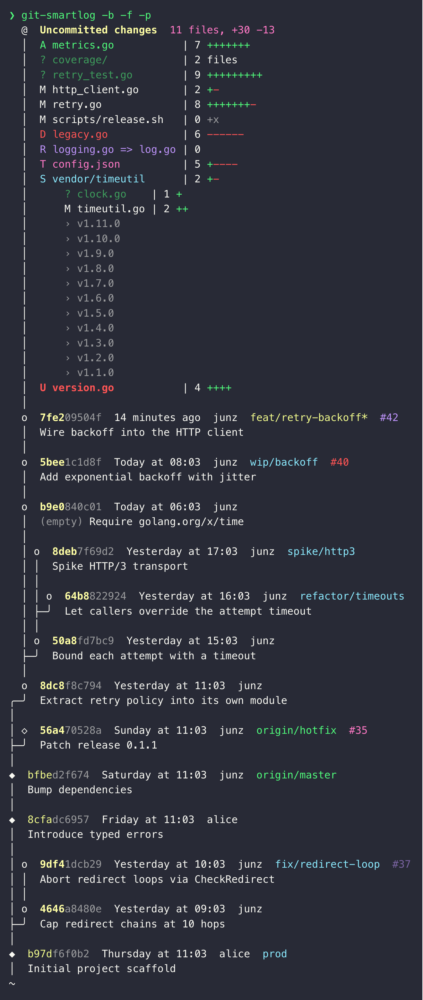
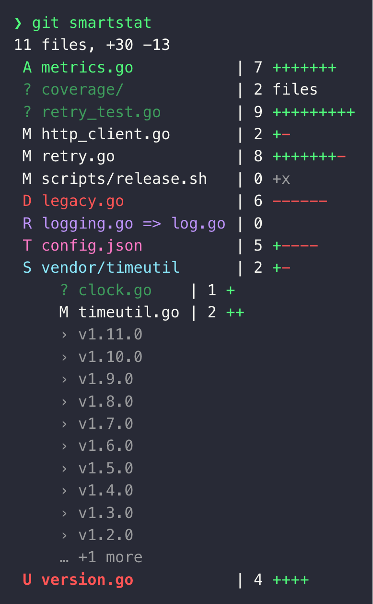

# git-smartlog

A [Sapling](https://sapling-scm.com/)-inspired `smartlog` for plain Git, in a single self-contained zsh script. The same file doubles as [`git-smartstat`](#git-smartstat), a standalone view of uncommitted changes, and [`git-smartshow`](#git-smartshow) / [`git-smartdiff`](#git-smartdiff), a two-pane diff browser — one commit's change, or a comparison of two points: the changed files as a tree on the left, the selected file's diff on the right.

It renders the current branch's **draft stack** — the first-parent chain of your local (unpushed) commits — drawn on top of its nearest **public** (pushed) base, with relative timestamps, authors, and ref decorations. A dirty working tree always draws an uncommitted-changes node on top, listing what you changed, and three independent flags — `-c` for per-file change stats under your commits, `-b` to fold your other local branches into the graph as full stacks, `-f` to stop abbreviating anything — combine freely. See below.

It began as a mimic of Sapling's `sl`, and still owes it the graph layout, the relative-time format and the color defaults. It has since grown enough of its own that it no longer tracks `sl`'s output, and isn't trying to. Four things come from [Jujutsu](https://github.com/jj-vcs/jj) instead: the uncommitted-changes node, since jj treats the working copy as a commit in its own right; the `(empty)` label on a commit that changed nothing; hashes that dim everything past the prefix which uniquely identifies them; and a node glyph that carries how rewritable the commit is (`o` → `◇` → `◆`) rather than leaving it to the palette.

The story behind it is in [this post](https://junz.info/writing/git-smartlog/).

<p align="center">
  
</p>

## Example

On a feature branch with a few local commits stacked on `origin/master`, with a clean working tree:

<!-- fixture: demo-clean -->
```text
$ git smartlog
  @  2f0e95dfc5  14 minutes ago  junz  feat/retry-backoff*
  │  Wire backoff into the HTTP client
  │
  o  6660e2b318  Today at 20:10  junz
  │  Add exponential backoff with jitter
  │
  o  859711ce71  Today at 18:10  junz
  │  (empty) Require golang.org/x/time
  │
  o  0280c2f0a8  Yesterday at 23:10  junz
╭─╯  Extract retry policy into its own module
│
◆  9126f994b8  Thursday at 23:10  junz  origin/master
│  Bump dependencies
~
```

`@` marks `HEAD`; the `o` nodes above the bend (`╭─╯`) are your draft commits, newest first. Below the bend sits the public base — the nearest pushed commit, here `origin/master`, drawn `◆` — and `~` marks the truncated history beyond it. This example and the next assume that clean tree: a dirty one always draws one more node on top, which is the section after them.

The node glyph is a ramp of how set in stone a commit is: **`o`** a draft that's still only yours, **`◇`** a draft already pushed to a remote — rewriting it costs a force-push — and **`◆`** a public commit. `@` outranks all three, wherever the working copy is. (`◇` needs a branch of yours on a remote to show up; it appears in the `-b` examples further down, on `origin/hotfix`.)

That ramp is shape rather than color on purpose. Indentation can't carry it — a `-b` side column is indented too — and neither can the palette: the draft and public hash colors are `\e[93m` and `\e[33m`, which are the *same yellow* in Dracula and most 16-color themes, so bold was doing all the work. Shape also survives `NO_COLOR`, a pipe, and every capture on this page.

A subject prefixed **`(empty)`** is a commit that changed nothing against its parent — here, a rebase onto `origin/master` found the dependency bump already applied and left the commit with nothing in it. Without the label an emptied commit is indistinguishable from one still carrying work; with it, the commit you want to drop says so. (`-c` gives such a commit no stat body at all, below.)

In a terminal the hash also splits: the shortest prefix that uniquely names the commit in this repo keeps the hash color and the digits past it go dim, so a row shows how much of a hash you actually have to type. It's a color effect only — the text is the same 10 digits either way, which is why these captures don't show it. The cover image up top does.

The public column stops at that base by design — one row plus `~`. `-f` / `--full` is the tool's one *don't abbreviate* switch, and it lifts three shortenings at once. Two show up here: older public history keeps streaming below the base instead of stopping (lazily, into the pager, like `git log` — scroll and it keeps going, down to the root commit), and public commits authored by *someone else*, which render metadata-only by default, get their author and subject back. The third is the submodule sub-line cap, further down.

<!-- fixture: demo-clean -->
```text
$ git smartlog -f
  @  2f0e95dfc5  14 minutes ago  junz  feat/retry-backoff*
  │  Wire backoff into the HTTP client
  │
  o  6660e2b318  Today at 20:10  junz
  │  Add exponential backoff with jitter
  │
  o  859711ce71  Today at 18:10  junz
  │  (empty) Require golang.org/x/time
  │
  o  0280c2f0a8  Yesterday at 23:10  junz
╭─╯  Extract retry policy into its own module
│
◆  9126f994b8  Thursday at 23:10  junz  origin/master
│  Bump dependencies
│
◆  13dfdace4e  Wednesday at 23:10  alice
│  Introduce typed errors
│
◆  566785cd0c  Tuesday at 23:10  alice
│  Initial project scaffold
~
```

Subjects are one line by design; `-m` / `--message` brings in the rest of the message — body lines render dim under each subject, blank lines and all, above any `-c` stat body. It covers every commit in view; the exception is public commits compacted to metadata-only, which stay that way (`-f` un-compacts them, bodies included). Here only the middle draft carries a body, which is the point — the flag costs nothing on one-line commits:

<!-- fixture: demo-clean -->
```text
$ git smartlog -m
  @  2f0e95dfc5  14 minutes ago  junz  feat/retry-backoff*
  │  Wire backoff into the HTTP client
  │
  o  6660e2b318  Today at 20:10  junz
  │  Add exponential backoff with jitter
  │  Full jitter: sleep a uniform random slice of the doubling window, so
  │  retries spread out instead of thundering in lockstep.
  │
  │  Cap the window at 30s — past that the ceiling matters more than the base.
  │
  o  859711ce71  Today at 18:10  junz
  │  (empty) Require golang.org/x/time
  │
  o  0280c2f0a8  Yesterday at 23:10  junz
╭─╯  Extract retry policy into its own module
│
◆  9126f994b8  Thursday at 23:10  junz  origin/master
│  Bump dependencies
~
```

A synthetic **Uncommitted changes** node is drawn on top of `HEAD` whenever the working tree is dirty — no flag needed, and **files and all**. Its header carries compact totals from `git diff --stat HEAD`; under it, one line per changed file. Every other node earns its one-line header by having a subject that says what it did — the working copy has none, so the file list is the whole of what it can tell you, and hiding it behind a flag would leave the node saying nothing. (That's what `-c` is for on *commits*, and its section — right after this one — is where the body format is spelled out; the node's body and `-c`'s are the same thing.) Loose untracked files are folded into the totals (as new-file additions) via a throwaway index overlay, so they count without touching the real index; a **wholly-untracked directory counts as one entry** rather than every file inside it, just like `git status`.

The `@` marker moves to the node — that's where the working copy is — and `HEAD` drops to an `o` (keeping its author and subject):

<!-- fixture: demo -->
```text
$ git smartlog
  @  Uncommitted changes  11 files, +30 -13
  │  A metrics.go           | 7 +++++++
  │  ? coverage/            | 2 files
  │  ? retry_test.go        | 9 +++++++++
  │  M http_client.go       | 2 +-
  │  M retry.go             | 8 +++++++-
  │  M scripts/release.sh   | 0 +x
  │  D legacy.go            | 6 ------
  │  R logging.go => log.go | 0
  │  T config.json          | 5 +----
  │  S vendor/timeutil      | 2 +-
  │      ? clock.go    | 1 +
  │      M timeutil.go | 2 ++
  │      › v1.11.0
  │      › v1.10.0
  │      › v1.9.0
  │      › v1.8.0
  │      › v1.7.0
  │      › v1.6.0
  │      › v1.5.0
  │      › v1.4.0
  │      › v1.3.0
  │      › v1.2.0
  │      … +1 more
  │  U version.go           | 4 ++++
  │
  o  9c88963f33  14 minutes ago  junz  feat/retry-backoff*
  │  Wire backoff into the HTTP client
  │
  o  edb0dc38e9  Today at 12:11  junz
  │  Add exponential backoff with jitter
  │
  o  d1a3bfbf91  Today at 10:11  junz
  │  (empty) Require golang.org/x/time
  │
  o  469c357174  Yesterday at 15:11  junz
╭─╯  Extract retry policy into its own module
│
◆  f5ad6667d7  Monday at 15:11  junz  origin/master
│  Bump dependencies
~
```

With `-c` / `--changes`, that same per-file stat block attaches to **every commit in the current stack**, clean or dirty (against each commit's first parent); sitting directly on the trunk (no stack), it covers **every public commit in view** instead — pair it with `-f` to walk back through it. Commit bodies close with a dim `N files, +X -Y` total line; the uncommitted node, which draws its body either way, keeps its total in the header it already had. An `(empty)` commit gets no body — there is nothing to stat, and its subject already says so.

Every body is `git diff --stat` bars with each filename prefixed by a one-letter change marker; both marker and name are color-coded by kind, on top of git's usual green/red `+`/`-` bars. Lines are **grouped by marker**, in the order below (sorted by path within each group, matching `git status`):

| marker | meaning | color |
| :-: | --- | --- |
| `A` | added (staged) | green |
| `?` | untracked | dim green |
| `M` | modified | default |
| `D` | deleted | red |
| `R` | renamed | blue |
| `T` | typechange (file↔symlink) | magenta |
| `S` | submodule | cyan |
| `U` | unmerged (conflict) | bold red |

`?` and `U` can only occur in the uncommitted node — a committed diff has neither. There, too, loose untracked files show up as their own entries and a wholly-untracked directory collapses to a single `dir/ | N files` line instead of expanding to every file inside it.

A pure executable-bit flip (`chmod`), which `--stat` renders as `| 0`, gets a trailing `+x`/`-x` hint. A **submodule** (`S`) expands into sub-lines under its stat line, in two groups of at most 10 lines each, each closing with a dim `… +N more` when it overflows (`-f` lifts the cap):

- its own **uncommitted changes** — this same stat block, recomputed inside the submodule and indented one level in, keeping its markers, colors and bars (a dirty submodule inside it nests again). Without this a merely dirty submodule says nothing at all: its recorded sha is unchanged, so git renders it as a bare `| 0`. Under a commit body there's no working tree to read, so this group is the uncommitted node's alone.
- the commits its pointer **gained or lost**, from `git diff --submodule=log`, newest first and dim — `›` for one gained, `‹` for one lost (a rewind); a bump git can't summarize (commits not present locally) adds none.

<!-- fixture: demo -->
```text
$ git smartlog -c
  @  Uncommitted changes  11 files, +30 -13
  │  A metrics.go           | 7 +++++++
  │  ? coverage/            | 2 files
  │  ? retry_test.go        | 9 +++++++++
  │  M http_client.go       | 2 +-
  │  M retry.go             | 8 +++++++-
  │  M scripts/release.sh   | 0 +x
  │  D legacy.go            | 6 ------
  │  R logging.go => log.go | 0
  │  T config.json          | 5 +----
  │  S vendor/timeutil      | 2 +-
  │      ? clock.go    | 1 +
  │      M timeutil.go | 2 ++
  │      › v1.11.0
  │      › v1.10.0
  │      › v1.9.0
  │      › v1.8.0
  │      › v1.7.0
  │      › v1.6.0
  │      › v1.5.0
  │      › v1.4.0
  │      › v1.3.0
  │      › v1.2.0
  │      … +1 more
  │  U version.go           | 4 ++++
  │
  o  2f0e95dfc5  14 minutes ago  junz  feat/retry-backoff*
  │  Wire backoff into the HTTP client
  │  M http_client.go | 15 ++++++++++++---
  │  M version.go     |  2 +-
  │  2 files, +13 -4
  │
  o  6660e2b318  Today at 20:10  junz
  │  Add exponential backoff with jitter
  │  A backoff.go | 13 +++++++++++++
  │  M retry.go   |  7 +++++++
  │  2 files, +20 -0
  │
  o  859711ce71  Today at 18:10  junz
  │  (empty) Require golang.org/x/time
  │
  o  0280c2f0a8  Yesterday at 23:10  junz
  │  Extract retry policy into its own module
  │  A retry.go       | 11 +++++++++++
  │  M http_client.go |  9 +++++----
  │  2 files, +16 -4
╭─╯
│
◆  9126f994b8  Thursday at 23:10  junz  origin/master
│  Bump dependencies
~
```

With `-b` / `--branches`, every **other local branch** joins the graph too, each rendering its **complete stack**. All heads' chains union into a forest, so a branch **forking from a draft commit** shows as a real fork, and commits **stacked above `HEAD`** — a branch containing `HEAD` while you're checked out mid-stack — appear too, with `@` drawn mid-tree. Fork points join the public column no matter how far down they sit, and commits skipped between them elide to a dotted `╷` spine. Two rules keep the graph quiet: a branch merged into the trunk just labels that commit instead of adding a node (`prod` below), and a branch whose same-name remote ref sits at the same commit shows only the remote name (`origin/hotfix`). Branch names render **cyan**, so they stand apart from green remote refs and the yellow active branch. Everything composes with `-c` and with the `-f` used here, which gives Alice's public commits their full headers, fills in the one trunk commit between `origin/master` and `fix/redirect-loop`'s fork point, and keeps the trunk streaming past the base:

<!-- fixture: demo -->
```text
$ git smartlog -b -f
  @  Uncommitted changes  11 files, +30 -13
  │  A metrics.go           | 7 +++++++
  │  ? coverage/            | 2 files
  │  ? retry_test.go        | 9 +++++++++
  │  M http_client.go       | 2 +-
  │  M retry.go             | 8 +++++++-
  │  M scripts/release.sh   | 0 +x
  │  D legacy.go            | 6 ------
  │  R logging.go => log.go | 0
  │  T config.json          | 5 +----
  │  S vendor/timeutil      | 2 +-
  │      ? clock.go    | 1 +
  │      M timeutil.go | 2 ++
  │      › v1.11.0
  │      › v1.10.0
  │      › v1.9.0
  │      › v1.8.0
  │      › v1.7.0
  │      › v1.6.0
  │      › v1.5.0
  │      › v1.4.0
  │      › v1.3.0
  │      › v1.2.0
  │      › v1.1.0
  │  U version.go           | 4 ++++
  │
  o  42216c35a5  14 minutes ago  junz  feat/retry-backoff*
  │  Wire backoff into the HTTP client
  │
  o  57daeb2140  Today at 08:02  junz  wip/backoff
  │  Add exponential backoff with jitter
  │
  o  4df6239fc9  Today at 06:02  junz
  │  (empty) Require golang.org/x/time
  │
  │ o  ddf1350b1d  Yesterday at 17:02  junz  spike/http3
  │ │  Spike HTTP/3 transport
  │ │
  │ │ o  edb584afbf  Yesterday at 16:02  junz  refactor/timeouts
  │ ├─╯  Let callers override the attempt timeout
  │ │
  │ o  411fccf502  Yesterday at 15:02  junz
  ├─╯  Bound each attempt with a timeout
  │
  o  0c9d82941c  Yesterday at 11:02  junz
╭─╯  Extract retry policy into its own module
│
│ ◇  5ddd520d79  Sunday at 11:02  junz  origin/hotfix
├─╯  Patch release 0.1.1
│
◆  f134637b2e  Saturday at 11:02  junz  origin/master
│  Bump dependencies
│
◆  5b149b2ab4  Friday at 11:02  alice
│  Introduce typed errors
│
│ o  e9a4f7c8de  Yesterday at 10:02  junz  fix/redirect-loop
│ │  Abort redirect loops via CheckRedirect
│ │
│ o  574ef1b7bd  Yesterday at 09:02  junz
├─╯  Cap redirect chains at 10 hops
│
◆  8a6c2f1a46  Thursday at 11:02  alice  prod
│  Initial project scaffold
~
```

At each fork the spine child (the one on `HEAD`'s path, else the newest subtree) continues the column and every other child opens a column one level deeper, newest first, closing with a `├─╯` bend right above the fork. Drop `-f` and the public window narrows back to the fork points themselves, so the trunk commit between them elides:

<!-- fixture: demo -->
```text
$ git smartlog -b
  @  Uncommitted changes  11 files, +30 -13
  │  A metrics.go           | 7 +++++++
  │  ? coverage/            | 2 files
  │  ? retry_test.go        | 9 +++++++++
  │  M http_client.go       | 2 +-
  │  M retry.go             | 8 +++++++-
  │  M scripts/release.sh   | 0 +x
  │  D legacy.go            | 6 ------
  │  R logging.go => log.go | 0
  │  T config.json          | 5 +----
  │  S vendor/timeutil      | 2 +-
  │      ? clock.go    | 1 +
  │      M timeutil.go | 2 ++
  │      › v1.11.0
  │      › v1.10.0
  │      › v1.9.0
  │      › v1.8.0
  │      › v1.7.0
  │      › v1.6.0
  │      › v1.5.0
  │      › v1.4.0
  │      › v1.3.0
  │      › v1.2.0
  │      … +1 more
  │  U version.go           | 4 ++++
  │
  o  9c88963f33  14 minutes ago  junz  feat/retry-backoff*
  │  Wire backoff into the HTTP client
  │
  o  edb0dc38e9  Today at 12:11  junz  wip/backoff
  │  Add exponential backoff with jitter
  │
  o  d1a3bfbf91  Today at 10:11  junz
  │  (empty) Require golang.org/x/time
  │
  │ o  ba349a0ba4  Yesterday at 21:11  junz  spike/http3
  │ │  Spike HTTP/3 transport
  │ │
  │ │ o  bda5ff01ae  Yesterday at 20:11  junz  refactor/timeouts
  │ ├─╯  Let callers override the attempt timeout
  │ │
  │ o  ced6e89fda  Yesterday at 19:11  junz
  ├─╯  Bound each attempt with a timeout
  │
  o  469c357174  Yesterday at 15:11  junz
╭─╯  Extract retry policy into its own module
│
│ ◇  d98069450f  Tuesday at 15:11  junz  origin/hotfix
├─╯  Patch release 0.1.1
│
◆  f5ad6667d7  Monday at 15:11  junz  origin/master
╷  Bump dependencies
╷
╷ o  f02cdf421c  Yesterday at 14:11  junz  fix/redirect-loop
╷ │  Abort redirect loops via CheckRedirect
╷ │
╷ o  abb3ea8725  Yesterday at 13:11  junz
╭─╯  Cap redirect chains at 10 hops
│
◆  1307e0e4e5  Saturday at 15:11  prod
│
~
```

Here `refactor/timeouts` forks off a draft of the current stack and `spike/http3` off a draft of *that* branch, so the layout nests one level further. Sibling subtrees render newest-first, and the child on `HEAD`'s path continues the column. Below `origin/master`, `fix/redirect-loop`'s fork point sits two commits down the trunk, so the commit between them elides to the dotted `╷` spine. `-f` fills a gap like that back in when it hides at most `$GIT_SMARTLOG_GAP_FILL` commits (default 10; `0` never fills); a wider one stays elided either way. A dirty working tree draws its uncommitted node directly above `HEAD`, wherever `HEAD` sits in the tree.

`--base REV` moves the bottom of the graph. The base is normally auto-detected — the nearest remote trunk — which covers `origin/main`, `origin/master` and a correctly-set `origin/HEAD`, and nothing else: a repo whose trunk is `develop` or `release/2.x`, or whose `origin/HEAD` is missing or stale after a rename, needs to be told. Here it's pointed at `prod`, the branch parked on the oldest public commit in the `-b` views above:

<!-- fixture: demo-clean -->
```text
$ git smartlog --base prod
  @  dab33f7027  14 minutes ago  junz  feat/retry-backoff*
  │  Wire backoff into the HTTP client
  │
  o  ed841edfda  Today at 09:31  junz
  │  Add exponential backoff with jitter
  │
  o  50869b41dd  Today at 07:31  junz
  │  (empty) Require golang.org/x/time
  │
  o  556467cccc  Yesterday at 12:31  junz
  │  Extract retry policy into its own module
  │
  ◇  a7bb6e6793  Friday at 12:31  junz  origin/master
  │  Bump dependencies
  │
  ◇  2142d53380  Thursday at 12:31  alice
╭─╯  Introduce typed errors
│
◆  39c359c11d  Wednesday at 12:31
│
~
```

Everything above the new base is a draft now, including `origin/master` — and since those two commits *are* on a remote, they draw `◇`. Which is the honest reading: relative to `prod` they're unmerged work, and they're published.

Note what `--base` does to `◆`: it means *at or below the base you named*, not *pushed*. Point it at a local branch you've never pushed and that commit still draws `◆` — you declared it the trunk, so the graph takes your word for it. Only the auto-detected base is guaranteed to be a remote ref.

With `-p` / `--prs` (needs the [GitHub CLI](https://cli.github.com/)), every branch name shown on a commit that has a GitHub PR gets a trailing `#N` tag — blue for open, dim blue for draft, magenta for merged, red for closed — and, on a TTY, an OSC 8 hyperlink to the PR. The flag is sticky per repo: once passed, later runs keep tagging without it until `-P` / `--no-prs` turns it off. The cover image up top shows the tags in all four states on the `-b` view.

In a real terminal the output is colorized — draft hashes in bold yellow, `HEAD`'s line in magenta, remote refs in green, `-b` branch names in cyan, and every hash dim past its unique prefix. ANSI is suppressed when stdout isn't a TTY (as in these captures) or when `NO_COLOR` is set — which is why `(empty)` and the `o`/`◇`/`◆` ramp are text and the hash dimming is not. Nothing is encoded in the hash color alone; two of the three yellows in a 16-color theme are the same yellow, so anything that mattered had to go in the glyph.

`◇` is deliberately weaker than jj's immutability line, which *excludes* remote bookmarks you track, on the grounds that rewriting your own pushed branch is routine. Painting a whole PR stack as frozen would be worse than saying nothing — hence the middle glyph rather than `◆`.

## Requirements

- `zsh`
- `git`

That's it. The script sources nothing else, so you can drop it anywhere on your `PATH` and run it — the uncommitted node included, since its stat block is computed in-file (see [git-smartstat](#git-smartstat)). The opt-in extras: `-p`/`--prs` needs the [GitHub CLI (`gh`)](https://cli.github.com/), and `git-smartshow`, `git-smartdiff` and `-i` need [`fzf`](https://github.com/junegunn/fzf) (plus [difftastic](https://difftastic.wilfred.me.uk/) if you want structural diffs). Everything else works without them.

## Install

```sh
curl -fsSL https://raw.githubusercontent.com/junzh0u/git-smartlog/main/git-smartlog \
  -o ~/.local/bin/git-smartlog
chmod +x ~/.local/bin/git-smartlog
# optional: the same file doubles as `git smartstat`, `git smartshow` and `git smartdiff` (see below)
ln -s git-smartlog ~/.local/bin/git-smartstat
ln -s git-smartlog ~/.local/bin/git-smartshow
ln -s git-smartlog ~/.local/bin/git-smartdiff
```

Because the script is named `git-smartlog` and lives on your `PATH`, Git picks it up as a subcommand — run it as `git smartlog`. A short alias is handy:

```sh
git config --global alias.sl smartlog
```

Zsh completions live in [`completions/`](completions/): put `_git-smartlog`, `_git-smartstat`, `_git-smartshow` and `_git-smartdiff` in a directory on your `fpath` before `compinit` runs. They complete the direct commands, and — with zsh's own `_git` — the `git smartlog` / `git smartstat` / `git smartshow` / `git smartdiff` subcommand forms too; add the subcommand *names* to `git <TAB>` with:

```sh
zstyle ':completion:*:*:git:*' user-commands \
    smartlog:'draft stack over its public base' \
    smartstat:'uncommitted working-tree stat block' \
    smartshow:'file tree beside the diff' \
    smartdiff:'file tree beside a comparison'
```

## Usage

All four commands take `-C <path>`, exactly as git does — run as if started in that directory, repeats composing — so you can point them at a repo without leaving the one you're in.

```
usage: git-smartlog [-C <path>] [-i] [-c] [-b] [-f] [-m] [-p|-P] [--base REV]

Sapling-inspired smartlog using only git: the current branch's draft stack
drawn on top of its nearest public (pushed) base. A dirty working tree always
draws an "Uncommitted changes" node on top of HEAD, listing its files.

The view flags below are independent and combine freely.

  -i, --interactive   browse the graph in fzf, always with -b -f: j/k (or
                      ctrl-j/k) step between commits and g/G, ctrl-f/b,
                      ctrl-d/u move like vim; the arrow, page and home/end
                      keys scroll the stat pane beside it (space pages it
                      down), which ? hides; enter opens the selected commit
                      in git-smartshow (the uncommitted node opens the
                      working copy), d compares it with the working copy
                      in git-smartdiff; / finds a row,
                      ctrl-j/k moving between matches (needs fzf; off a
                      terminal it prints the plain view, without the
                      implied -b -f, so it is safe in an alias)
  -c, --changes       show per-file changes under every commit in the current
                      stack — or under the public commit in view when HEAD
                      sits on the trunk (pair with -f for history); the
                      uncommitted node lists its files with or without it,
                      having no subject to say what it changed
  -b, --branches      show every other local branch as its full stack —
                      including forks at draft commits and commits stacked
                      above HEAD
  -f, --full          don't abbreviate: show author + subject on every commit
                      (including other authors' public ones, which otherwise
                      render metadata-only), keep streaming older
                      public history below the base — lazily when paged, like
                      git log — and stop capping a submodule entry's sub-lines
                      at 10; with -b, also fill a ╷ gap between fork points
                      when it hides at most $GIT_SMARTLOG_GAP_FILL commits
                      (default 10; 0 never fills) — wider gaps stay elided
  -m, --message       show full commit messages: body lines render dim under
                      each subject — every commit in view, except public
                      commits compacted to metadata-only (lift with -f)
  -p, --prs           tag shown branch names that have a GitHub PR with its
                      "#N" — colored by PR state, hyperlinked on a TTY
                      (needs the gh CLI); sticky — remembered per repo, so
                      later runs tag PRs without the flag
  -P, --no-prs        turn PR tagging off and forget the remembered -p
                      (wins when both are given)
      --base REV      override the public base (default: nearest remote trunk, e.g.
                      origin/HEAD, origin/main, origin/master, upstream/main) —
                      needed for any other trunk, e.g. develop or release/2.x.
                      Everything at or below REV then renders public (◆),
                      whether or not it has been pushed
  -C <path>           run as if started in <path>, like git's own -C; repeats
                      compose, each relative to the last
  -h, --help          show this help and exit

Output taller than the terminal is paged ($GIT_PAGER / core.pager / $PAGER /
less; GIT_PAGER=cat disables paging).
```

### Interactive

`git smartlog -i` puts the same graph in [`fzf`](https://github.com/junegunn/fzf), with the cursor on `@`. `j`/`k` step from commit to commit, and the rest of vim's motions move through the graph too — `g`/`G` to the first and last commit, `ctrl-f`/`ctrl-b` a page, `ctrl-d`/`ctrl-u` half a page — while the arrow, page and `home`/`end` keys scroll the side pane instead, and `space` pages it down. [`git-smartshow`](#git-smartshow) splits its keys the same way. `enter` opens the selected commit in [`git-smartshow`](#git-smartshow) — its files as a tree, its diff beside them — and quitting that brings you back to the same row. On the uncommitted node, `enter` opens the working copy instead. `d` compares the selected commit with the working copy in [`git-smartdiff`](#git-smartdiff) instead — everything from there to the files on disk, uncommitted and untracked changes included. A side pane shows the selected commit's header and stat; `?` hides it and brings it back. `/` finds a row by its text (`enter` or `esc` goes back to the graph on the match), `ctrl-r` re-renders after you commit in another pane, and `q` quits.

It always browses every branch with the full history — `-i` implies `-b -f`, since a scrollable list has no reason to abbreviate — and the other view flags combine with it: `git smartlog -i -c` is the full branch forest with per-file bodies, browsable. The graph is the regular renderer's own output: each row carries a hidden key naming the commit it belongs to, so a wrapped subject, a `-c` file line or a connector below a commit all open that commit. With `-f` in effect, fzf reads the streamed history to the end rather than lazily as you scroll. When stdout isn't a terminal, `-i` does nothing — the implied `-b -f` included — and the plain view prints, so it's safe to bake into an alias (`git config --global alias.sl 'smartlog -i'`) and still pipe `git sl`.

## git-smartstat

The uncommitted-changes block isn't just an add-on to the graph — it's also useful on its own. `git-smartlog` is **multi-call**: the same file, invoked under the name `git-smartstat`, prints *only* that block (the exact body the graph's node draws) as a standalone command. Symlink it and you get `git smartstat`:

```sh
ln -s git-smartlog ~/.local/bin/git-smartstat
```

```
usage: git-smartstat [-C <path>] [--color WHEN]

Show uncommitted working-tree changes as a compact stat block: a summary line
("2 files, +69 -2") followed by per-file diff bars; loose untracked files are
folded in and wholly-untracked directories collapse to a single entry like git
status. Each name carries a change marker — A added, ? untracked, M modified,
D deleted, R renamed, T typechange, S submodule, U unmerged — colored by kind.
Prints nothing when the working tree is clean. The same block git-smartlog draws
under its uncommitted-changes node.

      --color WHEN    colorize output: auto (default), always, or never
  -C <path>           run as if started in <path>, like git's own -C
  -h, --help          show this help and exit
```

<!-- fixture: demo -->
```text
$ git smartstat
11 files, +30 -13
 A metrics.go           | 7 +++++++
 ? coverage/            | 2 files
 ? retry_test.go        | 9 +++++++++
 M http_client.go       | 2 +-
 M retry.go             | 8 +++++++-
 M scripts/release.sh   | 0 +x
 D legacy.go            | 6 ------
 R logging.go => log.go | 0
 T config.json          | 5 +----
 S vendor/timeutil      | 2 +-
     ? clock.go    | 1 +
     M timeutil.go | 2 ++
     › v1.11.0
     › v1.10.0
     › v1.9.0
     › v1.8.0
     › v1.7.0
     › v1.6.0
     › v1.5.0
     › v1.4.0
     › v1.3.0
     › v1.2.0
     … +1 more
 U version.go           | 4 ++++
```

<p align="center">
  
</p>

A wholly-untracked directory collapses to a single entry — the way `git status` lists a new directory — with a file count in place of the `+`/`-` graph, right-justified into the same column as git's per-file line counts. That's the `coverage/` line above: two files inside, one line out, and it counts as one entry in the `11 files` total rather than two.

Paths are shown in full up to your terminal width; like `git diff --stat`, they shorten to a leading `...tail` only when the terminal is too narrow to fit them (piped output uses git's 80-column default).

It prints nothing when the working tree is clean. Both names share one in-file function (`uncommitted_stat`), so there's no duplicated logic and `git-smartlog` stays a single self-contained file — the node needs nothing external. (Standalone, `git-smartstat` also works in a repo with no commits yet, diffing against the empty tree so staged and untracked files still show as additions.)

## git-smartshow

A diff browser laid out like a code-review page: the changed files as a tree in a sidebar, the selected file's diff in the main pane beside it. It's the third name for the same file, and it needs [`fzf`](https://github.com/junegunn/fzf), which draws both panes:

```sh
ln -s git-smartlog ~/.local/bin/git-smartshow
```

```
usage: git-smartshow [options] [<rev>] [-- <path>...]

git show in a two-pane browser: the changed files as a tree, the selected
file's diff beside it.

  git-smartshow          uncommitted changes, untracked too; HEAD's if clean
  git-smartshow <rev>    <rev>'s own change, as git show <rev>

To compare two points, use git-smartdiff.

Keys:
  j / k               next / previous file; g / G first / last
  ctrl-f / ctrl-b     page the file list; ctrl-d / ctrl-u half a page
  h / l               fold / unfold a directory (h on a file jumps to its directory)
  ↑ / ↓               scroll the diff; page-down (or space) / page-up a page,
                      home / end to either end
  t                   switch between difftastic and git's own diff
  /                   find a path (enter or esc returns to the tree)
  ctrl-r              reload after the working tree changed
  q, esc              quit

Options:
      --tool TOOL     diff renderer: auto (default — difft when installed), difft,
                      or git; $GIT_SMARTSHOW_TOOL sets the default
      --list          print the sidebar's file tree and exit
  -C <path>           run as if started in <path>, like git's own -C
  -h, --help          show this help and exit

Needs fzf. Piped, it prints the diff once and exits.
```

With no arguments it opens `@` — the node `git smartlog` marks `@`. On a dirty tree that's the uncommitted changes, and the sidebar lists exactly the files the uncommitted node does, with the same markers and colors. Untracked files diff as new files through the same throwaway index, and an untracked directory unfolds into its files, since the tree can fold it back. The sidebar is what `--list` prints:

<!-- fixture: demo -->
```text
$ git smartshow --list
▾ coverage/  +2
  ? http_client.out  +1
  ? retry.out  +1
▾ scripts/
  M release.sh +x
▾ vendor/  +1 -1
  S timeutil  +1 -1
A metrics.go  +7
? retry_test.go  +9
M http_client.go  +1 -1
M retry.go  +7 -1
D legacy.go  -6
R log.go  ← logging.go
T config.json  +1 -4
U version.go  +4
```

Directories come first, then files in the stat block's group order. A chain of directories that holds nothing but one more directory compresses into a single row, the way editors show compact folders. Selecting a directory row shows the diff of everything under it.

The diff pane uses [difftastic](https://difftastic.wilfred.me.uk/) when `difft` is on your `PATH`, sized to the pane, so a wide terminal gets difft's side-by-side view. `t` switches to git's own colored diff and back. difft runs as git's external diff, so git still handles rename pairing, pathspecs and the untracked overlay either way.

Piped, `git smartshow` prints the diff once and exits — git's renderer unless `--tool difft` asks otherwise — so `git smartshow | less` and `git smartshow HEAD~2 > change.diff` behave like their git counterparts, untracked files included.

## git-smartdiff

The same browser, reading its revisions like `git diff` rather than `git show`: where `git smartshow` shows one change, `git smartdiff` compares two points. It's the fourth name for the file:

```sh
ln -s git-smartlog ~/.local/bin/git-smartdiff
```

```
usage: git-smartdiff [options] [<rev> [<rev>] | <rev>..<rev>] [-- <path>...]

git diff in a two-pane browser: the changed files as a tree, the selected
file's diff beside it. Unlike git diff, the working copy is the files on
disk — staged or not, untracked included.

  git-smartdiff          HEAD → working copy: all uncommitted changes
  git-smartdiff <rev>    <rev> → working copy
  git-smartdiff <a> <b>  <a> → <b>, as git diff <a> <b>; <a>..<b> too

For one commit's own change, use git-smartshow.

Keys:
  j / k               next / previous file; g / G first / last
  ctrl-f / ctrl-b     page the file list; ctrl-d / ctrl-u half a page
  h / l               fold / unfold a directory (h on a file jumps to its directory)
  ↑ / ↓               scroll the diff; page-down (or space) / page-up a page,
                      home / end to either end
  t                   switch between difftastic and git's own diff
  /                   find a path (enter or esc returns to the tree)
  ctrl-r              reload after the working tree changed
  q, esc              quit

Options:
      --tool TOOL     diff renderer: auto (default — difft when installed), difft,
                      or git; $GIT_SMARTSHOW_TOOL sets the default
      --list          print the sidebar's file tree and exit
  -C <path>           run as if started in <path>, like git's own -C
  -h, --help          show this help and exit

Needs fzf. Piped, it prints the diff once and exits.
```

The working copy stands in for git's index, untracked files included: with no revision it's the uncommitted changes, and one revision compares that commit with the files on disk — what `d` opens from `git smartlog -i`. Here `HEAD`'s own change to `http_client.go` and `version.go` folds into the uncommitted ones:

<!-- fixture: demo -->
```text
$ git smartdiff --list HEAD~1
▾ coverage/  +2
  ? http_client.out  +1
  ? retry.out  +1
▾ scripts/
  M release.sh +x
▾ vendor/  +1 -1
  S timeutil  +1 -1
A metrics.go  +7
? retry_test.go  +9
M http_client.go  +12 -3
M retry.go  +7 -1
D legacy.go  -6
R log.go  ← logging.go
T config.json  +1 -4
U version.go  +5 -1
```

Two revisions or a range compare those, like `git diff main feature` or `git diff main..feature`. `git smartshow` takes one revision at most and points at `git smartdiff` when given two.

## How it works

- **Public base** — the nearest public ancestor of `HEAD`. Candidate trunks are remote-tracking refs only (`origin/HEAD`, `upstream/HEAD`, `origin/main`, `origin/master`, `upstream/main`, `upstream/master`); among those, the one whose merge-base with `HEAD` is closest to `HEAD` wins. `@{u}` and a local `main`/`master` are last-resort fallbacks when no remote trunk exists. That list is the whole heuristic, so any other trunk needs `--base REV` — which redefines "public" for the run as *at or below that rev*. A base you name is taken at your word, so `◆` there means "below the base", not "pushed"; only the auto-detected base is guaranteed to be a remote ref.
- **Drafts** — first-parent commits in `HEAD ^base`, newest first.
- **Symbols** — `@` where the working copy is, then a ramp: `o` unpushed draft, `◇` pushed draft, `◆` public. jj's idea: the node carries the phase, so it survives `NO_COLOR`, a pipe, and a `-b` side column's indentation. Shape and not color because `\e[93m`/`\e[33m` are one yellow in most themes.
- **Pushed drafts** — a draft reachable from any remote-tracking ref draws `◇`. One `git rev-list <draft heads> --not --remotes` prints the drafts that *aren't*, so the ones it omits are pushed; the walk stops at the remote boundary, so it's bounded by the unpushed set, and it's skipped entirely in a repo with no remotes. (`--no-walk` doesn't restrict that to the argument set — with `--not` in play git walks regardless.)
- **Hashes** — 10 digits, but only the leading ones matter: a second `%h` at `--abbrev=4` in the same `git log` pass asks git for the shortest prefix that names exactly one object, and the digits past it render dim. jj's idea — its ids show at a glance how much you'd have to type. A repo big enough to collide inside 10 digits is shown the wider unique prefix instead of an ambiguous hash, the way git widens its own output.
- **`(empty)`** — a commit whose tree equals its first parent's (the empty tree for a root commit) gets its subject prefixed `(empty)`, and no `-c` body. jj labels these in its log; git doesn't, so an emptied commit looks like any other. Decided from tree hashes, not diffs: `%T` rides along with the metadata every row already fetches, and the handful of parents outside the window are fetched in one batch rather than a `rev-parse` per row. In the `-f` tail, where there is no window to batch over, rows are held one behind — in a first-parent walk the next record *is* the previous row's parent.
- **Uncommitted changes** — whenever `git status` is non-empty, a synthetic node on top of `HEAD` carrying compact totals plus per-file `git diff --stat HEAD` bars; the `@` marker moves there. Borrowed from jj, where the working copy *is* a commit and needs no synthesis. The bars need no flag, unlike a commit's: a commit's subject already says what it did, so `-c` is an ask; the working copy has no subject, so its files *are* the description. Totals and bars alike are computed against a throwaway index overlay that intent-to-adds loose untracked files so they're folded in without mutating the repo (a wholly-untracked directory instead collapses to one `dir/ | N files` entry, like `git status`). Each body filename gets a one-letter change marker (`A`/`?`/`M`/`D`/`R`/`T`/`S`/`U`, from `git diff --raw`, plus the porcelain status for conflicts) colored by kind (see the marker table above), and a `+x`/`-x` hint on executable-bit flips. This block is computed by the in-file `uncommitted_stat` function — the same code the [`git-smartstat`](#git-smartstat) command runs.
- **Public window** — one commit: the base, with `~` below it. `-f` streams the history below instead.
- **Other branches** — with `-b`/`--branches`, every head's first-parent chain is unioned into a forest of draft trees (shared prefixes dedup), each rendered above its root's public fork point: the spine child continues the column, side subtrees open one column deeper per fork level and close with a `├─╯` bend above the fork. Sibling subtrees order by newest commit date and the spine prefers `HEAD`'s path — Git has no revision numbers to sort by. Includes commits stacked above `HEAD`. Fork points are added to the public column no matter how far down they sit, with commits skipped between them eliding to a dotted `╷` spine — unless `-f` is on and the gap is at most `$GIT_SMARTLOG_GAP_FILL` commits (default 10; `0` never fills), in which case they render in full. Branch names render cyan so they stand apart from green remote refs. Two branches don't get a node of their own: one merged into the trunk (its head *is* the merge-base) labels that public commit instead, and one whose same-name remote ref sits at the same commit shows only the remote name.
- **PR numbers** — with `-p`/`--prs`, every branch name shown on a commit (the active branch, a remote bookmark, or a `-b` local) that has a GitHub PR gets a trailing `#N` tag: blue for open, dim blue for draft, magenta for merged, red for closed — and, on a color-capable TTY, an OSC 8 hyperlink to the PR. One `gh pr list --state all` call maps branches to PRs (a branch with several keeps an open one over closed/merged, else the newest); the trunk's own branch is skipped so its long-merged PR doesn't tag every graph. The call's ~1s API round-trip is cached per repo in the git dir for `$GIT_SMARTLOG_PR_TTL` seconds (default 60; `0` forces a refetch), so only the first `-p` run in a while pays it. Needs the GitHub CLI (`gh`); a failed listing warns and falls back to the stale cache, else renders without tags. `-p` is sticky per repo — it drops a marker file in the git dir (`smartlog-pr-on`), so later runs tag PRs without the flag; `-P`/`--no-prs` removes the marker and turns tagging off (winning when both are given). When tagging is on only via the marker, a missing `gh` warns instead of erroring, so plain runs keep working on a machine without it.
- **Subjects** — shown in full, never truncated to the terminal width, so a long one wraps rather than ending in an ellipsis. On a TTY the wrap is the renderer's own: word-boundary continuation rows that keep the gutter and align under the subject column. Piped output leaves the line whole.
- **Message bodies** — with `-m`/`--message`, each commit's message body renders dim line-by-line under its subject, above any `-c` stat body. Long lines word-wrap to the terminal width, continuation rows keeping the gutter and the line's leading indent; piped output stays unwrapped. The window's bodies come from one extra batched `git log` pass (NUL-separated — bodies are multi-line); the `-f` streamed tail fetches one body per row, lazily, like its `-c` stats.
- **Color** — ANSI, automatically suppressed when stdout isn't a TTY or `NO_COLOR` is set.
- **Paging** — output taller than the terminal is piped through a pager (`$GIT_PAGER`, then git's `core.pager`, then `$PAGER`, then `less` with `LESS=FRX` like git). Output that fits, or piped/redirected output, prints directly; `GIT_PAGER=cat` disables paging. Colors survive the pager.
- **Infinite scroll** — with `-f`/`--full`, the public column doesn't stop at the base: older history keeps streaming below it — lazily when paged, so scrolling keeps revealing commits like plain `git log`, down to the root commit. Without `-f` the base row and the trailing `~` truncation row are unconditional. `-f` is the one *don't abbreviate* switch, so the same flag also restores full headers on other authors' public commits and lifts the 10-line cap on a submodule entry's sub-lines — the only way to see every commit a big bump brought in. It fills `-b`'s `╷` elision only for small gaps — at most `$GIT_SMARTLOG_GAP_FILL` commits (default 10; `0` never fills): this tail streams lazily and only downward, one row per scroll, while filling the gaps *between* fork points is eager — a branch forking 200 commits down the trunk would push every other tree off screen. Keeping distant fork points adjacent is the whole point of the `-b` view, so wider gaps stay elided.

## License

[MIT](LICENSE)
